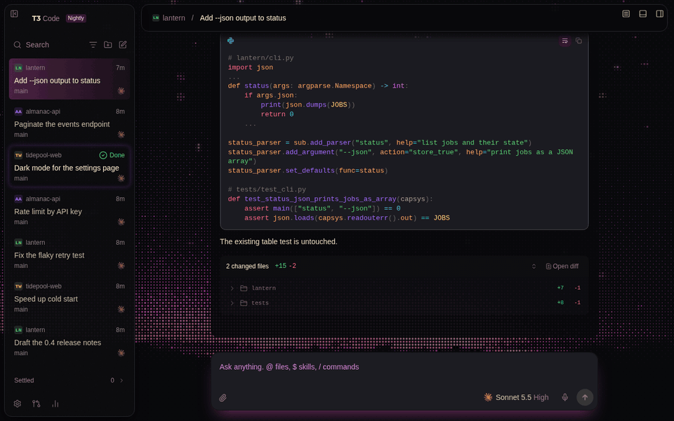
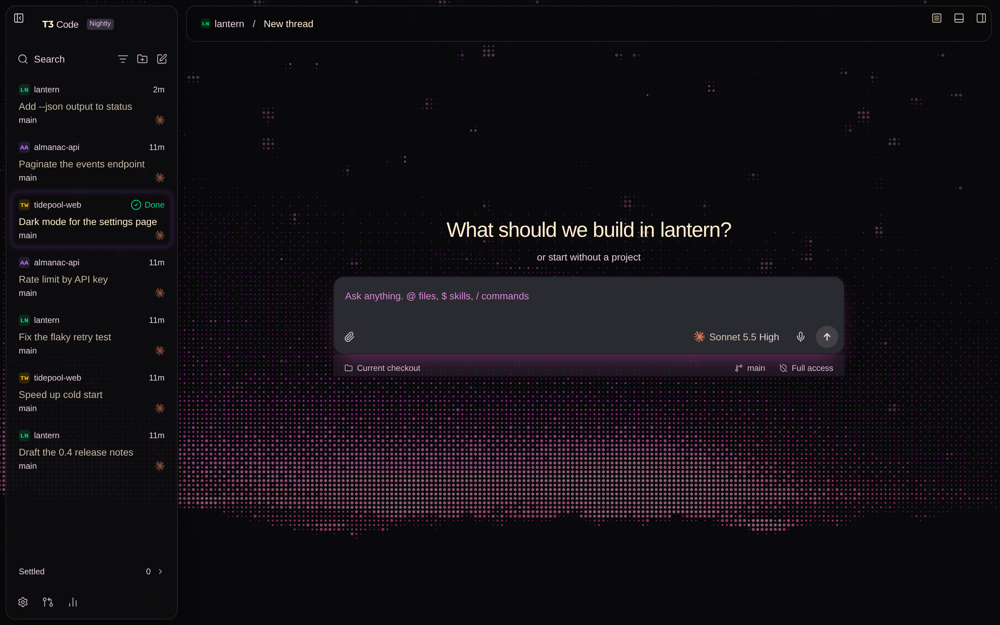
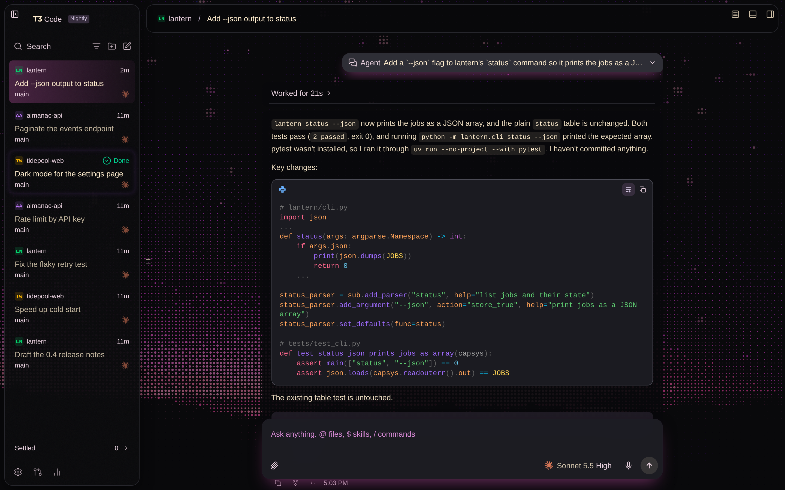
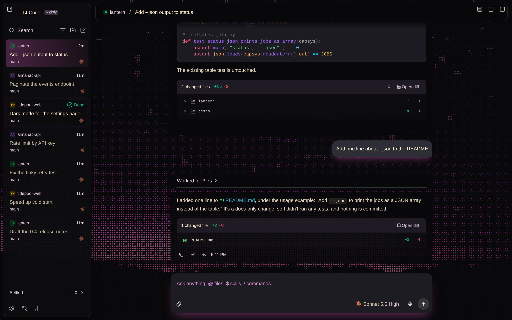
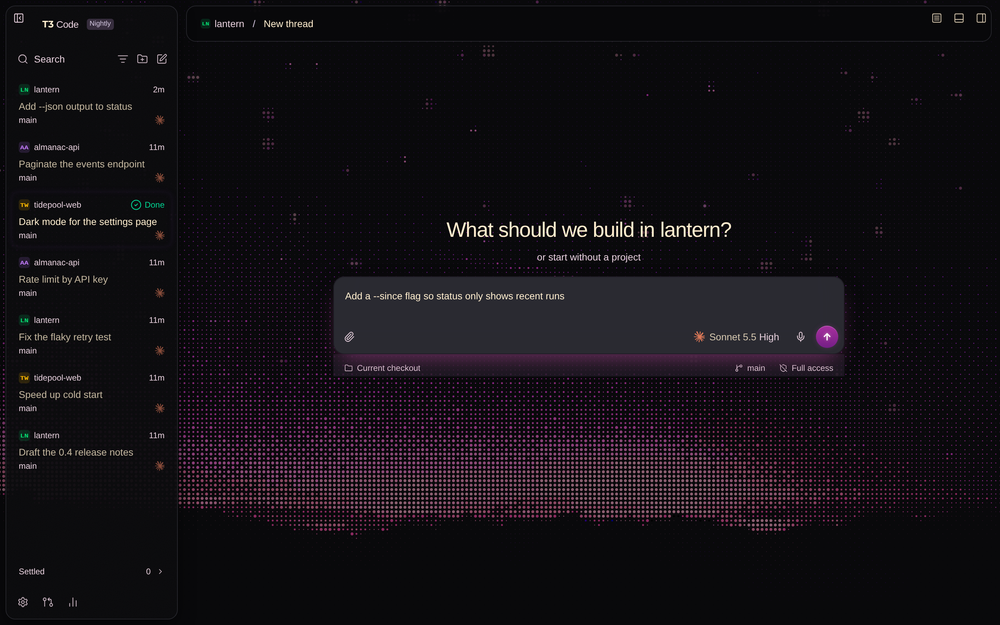
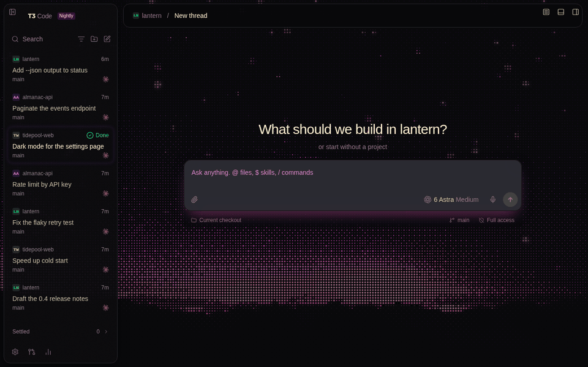
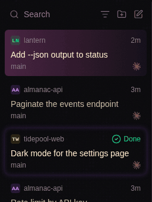

# Starry Ridge

A dark theme for [T3 Code](https://t3.codes) that puts a dotted night sky behind the app. Stars sparkle
faintly, a shooting star crosses now and then, and the panels float over the sky as dark cards.



## Screenshots







The send button is matte while the composer is empty and lights up when there is something to send:



A shooting star crosses the upper sky, and the stars sparkle a few at a time:



Threads with a result you have not read yet breathe with a faint glow:



The screenshots show T3 Code with invented demo projects.

## Install

1. Download [`theme.json`](theme.json).
2. In T3 Code, open **Settings**, then **Appearance**.
3. Under **Themes**, click **Add theme**.
4. Click **Choose files**, select `theme.json`, then click **Add theme**.

T3 Code switches to Starry Ridge. To go back, pick another theme on the same page.

Tested on T3 Code 0.1.10-nightly.20261114, in the Linux desktop app and in the web client in Chromium.

## What moves

- **Shooting star:** crosses the upper sky every 9 seconds for four passes, then rests for 9 seconds.
- **Stars:** a different handful flares faintly every few seconds.
- **Unread threads:** a sidebar thread with an unread result breathes with a faint violet glow.
- **Send button:** lights up when the composer has text.

If your system asks for reduced motion, nothing moves.

## Change it

The theme is generated. Edit the constants at the top of `build.mjs`, then build again.

| Constant | What it does | Default |
|---|---|---|
| `DOT_SCALE` | Dot size, relative to the original artwork | `0.65` |
| `SKY_TONE` | Sky brightness as red, green, and blue multipliers | `[0.55, 0.4, 0.55]` |
| `SCRIM_ALPHA` | Opacity of the dark card behind each conversation row | `0.9` |
| `PANEL_ALPHA` | Opacity of the sidebar, header, and composer | `0.94` |
| `TWINKLE.peak` | Strength of a star's flare | `0.18` |
| `TWINKLE.rest` | Brightness of a sparkling star between flares | `0.55` |
| `TWINKLE.cycles` | Seconds per sparkle cycle, one value per star group | `[7, 9.5, 11, 13, 8.2]` |

`DESIGN.md` records the design rules the theme follows and the reason for each.

## Build from source

You need Node.js. The build is tested with Node.js 26.

```sh
npm ci
node build.mjs
```

`build.mjs` writes `theme.json`.

To check the result, run:

```sh
node check.mjs
```

`check.mjs` needs a Chromium binary. If yours is not at `/usr/bin/chromium`, set `CHROMIUM` to its path.
The check validates the theme file, checks text contrast, and compares the sky against the original
artwork's own renderer. It writes `reference-*.png` and `compare-*.png` next to the script.

## Limits

- **Size:** T3 Code allows 20,000 characters of theme CSS. This theme uses about 18,800, so there is little room to add more.
- **Internal selectors:** some effects hook into parts of T3 Code that its theme guide does not list as
  stable: the floating sidebar, the per-row cards, the unread glow, and the send button. A T3 Code
  update can switch one of them off. The rest of the theme keeps working.
- **Dark only:** the theme defines a dark appearance.
- **Mobile:** T3 Code's theme guide says its mobile apps do not use themes.

## Credits and license

The code and styling are under the [MIT License](LICENSE).

The sky is built from the "Starry Ridge" piece in
[ascii-magic-art](https://www.ascii-magic.com/ascii/starry-ridge), a halftone rendering of a photograph
by Vincentiu Solomon on Unsplash. That image data stays under the Unsplash License, not MIT.
[NOTICE.md](NOTICE.md) has the details.

This theme is not affiliated with T3 Code.
